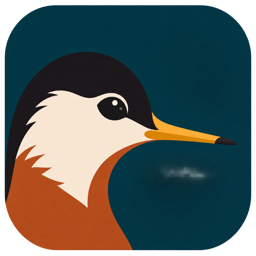

# Thor Browser

Thor Browser is based on Ladybird and uses ThorVG for page rendering. Published by KarthikeyanRanasthala independently of the Ladybird Browser Initiative.

[Download Thor Browser for Apple Silicon](https://github.com/KarthikeyanRanasthala/thor-browser/releases/latest) · [Installation and build instructions](Documentation/BuildInstructionsLadybird.md#installing-and-publishing-the-thorvg-macos-builds)

[Project decisions, test results, and next steps](Documentation/ThorBrowserDecisions.md)

## About the logo

Thor Browser takes its name from ThorVG, the library that paints its pages. The red phalarope caught our eye because its Icelandic name, *þórshani*, echoes Thor. The app icon shows its head and body in close-up so you can still recognize it at Dock size.

## About upstream Ladybird

[Ladybird](https://ladybird.org) is a truly independent web browser, using a novel engine based on web standards.

> [!IMPORTANT]
> Ladybird is in a pre-alpha state, and only suitable for use by developers
>

## Features

We aim to build a complete, usable browser for the modern web.

Ladybird uses a [multi-process architecture](Documentation/ProcessArchitecture.md) with a main UI process,
WebContent renderer processes, and helper processes for tasks such as networking, image decoding, compositing and media.

Documents from different sites run in separate renderer processes, each sandboxed from the rest of the system.
Image decoding and network connections are done out of process, separately for each site, to be more robust against
malicious content.

At the moment, many core library support components are inherited from SerenityOS:

- LibWeb: Web rendering engine
- LibJS: JavaScript engine
- LibWasm: WebAssembly implementation
- LibCrypto/LibTLS: Cryptography primitives and Transport Layer Security
- LibHTTP: HTTP/1.1 client
- LibGfx: 2D Graphics Library, Image Decoding and Rendering
- LibUnicode: Unicode and locale support
- LibMedia: Audio and video playback
- LibCore: Event loop, OS abstraction layer
- LibIPC: Inter-process communication

## How do I build and run this?

See [build instructions](Documentation/BuildInstructionsLadybird.md) for information on how to build Ladybird.

Ladybird runs on Linux, macOS, Windows (with WSL2), and many other \*Nixes.

## How do I read the documentation?

Code-related documentation can be found in the [documentation](Documentation/) folder.

## Get in touch and participate!

Join [our Discord server](https://discord.gg/nvfjVJ4Svh) to participate in issue and development discussions.

Please read [Getting involved with Ladybird](Documentation/GettingStartedContributing.md) if you're new to Ladybird and want to help.

Before opening an issue, please see the [issue policy](CONTRIBUTING.md#issue-policy) and the [detailed issue-reporting guidelines](ISSUES.md).

The project participation guidelines can be found in [`CONTRIBUTING.md`](CONTRIBUTING.md).

## License

Ladybird is licensed under a 2-clause BSD license.
